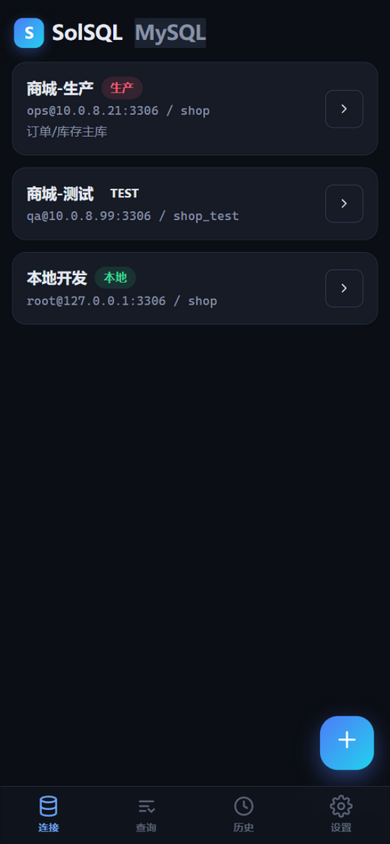
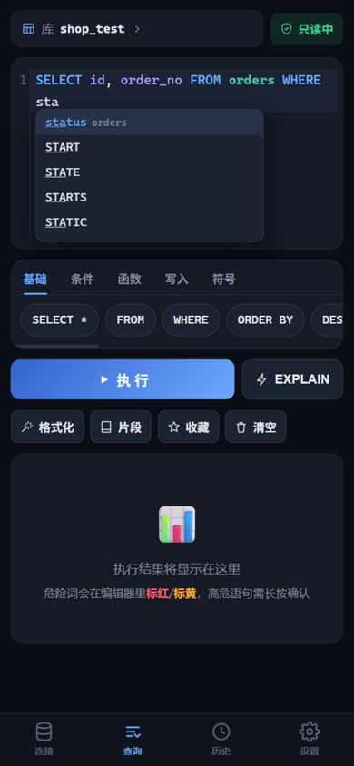
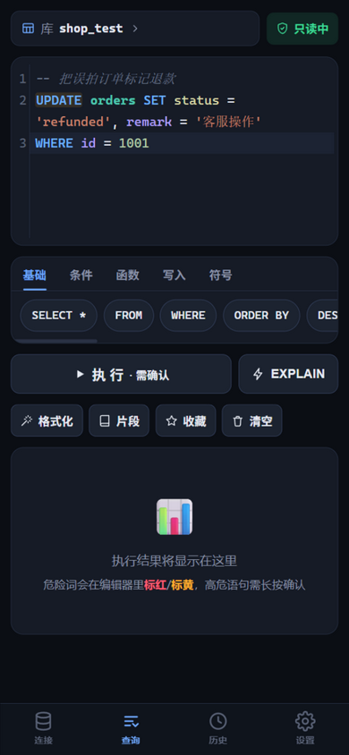
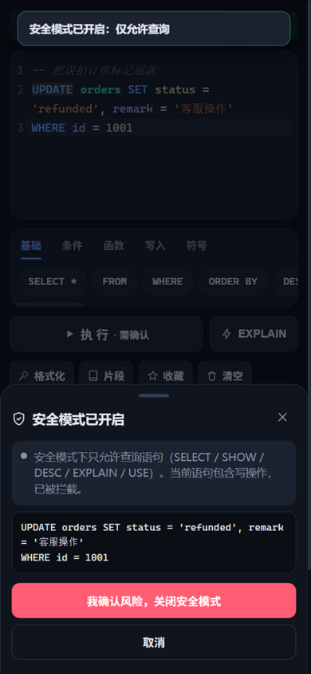
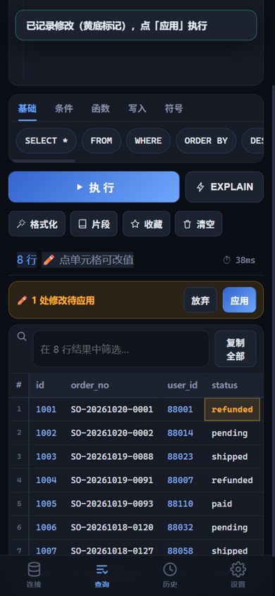
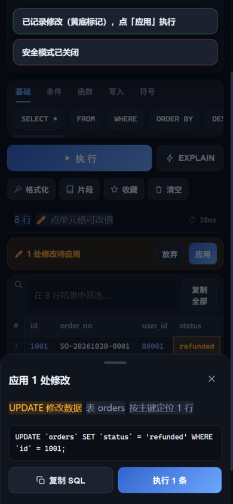
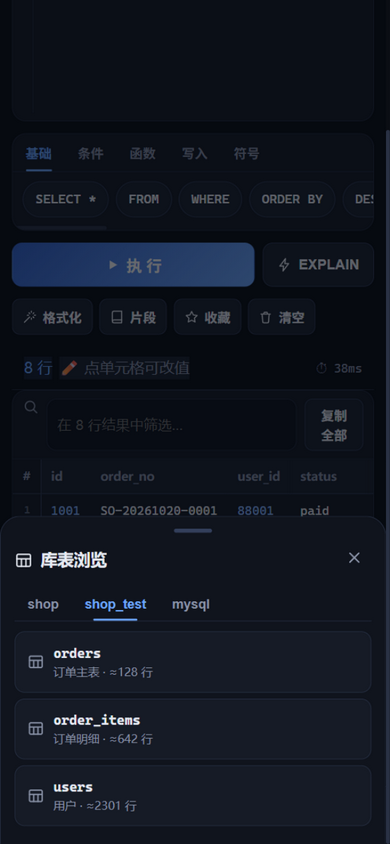

# SolSQL

> 为「拿着手机处理线上问题」设计的开源移动端 SQL Client，当前支持 MySQL。

[](./LICENSE)


### 我实在找不到好用的手机端友好的数据库管理工具，所以有了这个(这句话是真人，以下转AI)

在手机上写 SQL 运维，痛点不是「能不能写」，而是「不方便」和「不敢写」。SolSQL 把两件事做到位：

- **为手机输入提效**：SQL 关键词快捷栏、智能表/字段补全、片段模板、一键格式化
- **为误操作设防**：危险语句实时标红/标黄、高危长按确认、无 WHERE 的 UPDATE/DELETE 拦截、安全只读模式、生产环境红条

网关内嵌在 App 里（nodejs-mobile），手机在 WiFi/VPN 内**直连 MySQL，不经任何中间服务器**；连接密码 AES-256-GCM 加密存储在本机。

产品设计与痛点分析见 [PRODUCT.md](./PRODUCT.md)。

## 截图

| 连接管理（环境标识） | 智能字段补全 | 语法高亮 + 危险词标色 |
|:---:|:---:|:---:|
|  |  |  |

| 安全模式拦截 | 结果集单元格编辑 | 应用修改（生成 UPDATE 确认） |
|:---:|:---:|:---:|
|  |  |  |

| 库表浏览器 |
|:---:|
|  |

> 截图中的连接、库表均为演示数据。

## 功能一览

| 类别 | 功能 |
|------|------|
| 输入提效 | SQL 关键词快捷栏（基础/条件/函数/写入/符号）、**智能补全**（语句里出现过的表的字段直接弹，无需打 `表名.`）、片段模板、一键格式化、语法高亮（关键词/表名/字段名分色，深浅主题各一套） |
| 防误操作 | 危险词编辑器实时标红(DROP/TRUNCATE/GRANT…)/标黄(UPDATE/DELETE/INSERT…)；无 WHERE 的 UPDATE/DELETE 识别为高危；执行前风险弹层逐条列原因；**高危需长按 1.2s 确认**；UPDATE/DELETE 一键「预览影响行数」；多语句拦截 |
| 结果编辑 | **点单元格改值 → 生成按主键定位的 UPDATE → 确认执行**（单表简单查询可编辑，JOIN/聚合不可编辑，BLOB 不可编辑，全程确认层展示生成 SQL） |
| 安全模式 | 只读开关：开启后仅允许 SELECT/SHOW/DESC/EXPLAIN/USE |
| 环境防护 | 连接分环境（生产/预发/测试/本地），生产环境全程红条警示 + 双重确认 |
| 结果阅读 | 冻结表头/首列、行号、点单元格全屏查看（JSON 格式化/BLOB hex）、列排序、结果内筛选、复制单元格/整行/全部 |
| 其他 | 库表浏览器（结构/索引/DDL/行数）、查询历史+收藏、一键 EXPLAIN、常见错误码人性化翻译、深/浅色主题、行数截断保护 |

## 下载与安装（Android）

从 [Releases](../../releases) 下载最新 APK（arm64-v8a，debug 签名），传到手机点击安装（允许未知来源）。已有连接配置会被保留。

## 自己构建 APK

前置：Node 18+、JDK 21、Android SDK（platform-tools / platforms;android-36 / build-tools / NDK 27 / CMake 3.22.1，可由 gradle 自动安装）。

```bash
npm install
npm run apk
# 产物：android/app/build/outputs/apk/debug/app-debug.apk（约 90MB）
adb install -r android/app/build/outputs/apk/debug/app-debug.apk
```

`npm run apk` 依次执行：构建 Web（vite）→ 打包网关为单文件 CJS（esbuild）→ 同步进 Android 工程 → gradle assembleDebug。

### ⚠ 中文 Windows 用户名的坑

如果 Windows 用户目录含中文（如 `C:\Users\张三`），cmake/ndk 会启动崩溃（退出码 0xC0000409）。解决办法：把 SDK、gradle 缓存、JDK 全部放到纯英文路径，构建时设置：

```bash
export JAVA_HOME="D:\devtool\jdk\jdk21" ANDROID_HOME="D:\devtool\AndroidSdk" \
       GRADLE_USER_HOME="D:\devtool\gradle-home" TMP="D:\tmp" TEMP="D:\tmp"
```

### 国内网络提示

- Gradle 发行包已配置腾讯镜像、maven 仓库已配置阿里云镜像（android/ 下配置文件已改好）
- nodejs-mobile 运行时（100MB）从 GitHub Releases 下载，直连超时时可用镜像前缀手动下载并放入 `$GRADLE_USER_HOME/caches/capawesome-capacitor-nodejs/`（文件名与 SHA256 见 `node_modules/@capawesome/capacitor-nodejs/android/build.gradle`），gradle 会自动跳过下载

### APK 架构

- UI（WebView，Capacitor）+ 网关（内嵌 Node 18 运行时跑 Express + mysql2，监听 127.0.0.1:9410）
- 手机直连 MySQL，无中间服务器；连接密码加密后存 App 私有数据目录，卸载即清除
- 安卓返回键：先关弹层 → 页面后退 → 退出 App

## 快速开始（Web 版）

```bash
npm install
npm run build     # 构建前端
npm start         # 本机访问 http://127.0.0.1:9410
npm run start:lan # 监听 0.0.0.0，同一局域网的手机浏览器访问 电脑IP:9410
npm run dev       # 开发模式：vite:5173 + api:9410 热更新
```

## 测试

```bash
npm test               # 全部（危险分析 35 断言 + 结果集编辑 34 断言）
```

## 安全设计

- 网关默认只绑定 `127.0.0.1`；局域网模式（`start:lan`）请确保网络可信
- 连接密码 AES-256-GCM 加密落盘（`data/` 目录，已 gitignore，不会进入仓库）
- 服务端兜底：单语句限制（`multipleStatements: false`）、最大返回行数截断（默认 500，上限 5000）
- 危险分析在前端执行（执行前拦截），不依赖服务端

## 技术栈

React 18 + Vite + zustand + CodeMirror 6（MySQL 方言、自定义 Decoration）/ Express + mysql2（单连接串行队列，保证 USE/SET 会话状态一致）/ Capacitor 8 + nodejs-mobile

## 目录结构

```
├── PRODUCT.md            # 产品设计文档（痛点分析、功能规划）
├── server/               # Node 网关：连接管理(加密)、查询代理、schema 接口
├── web/                  # 移动端 Web UI
│   ├── src/lib/sqlDanger.js  # SQL 危险分析引擎（纯函数）
│   └── src/lib/editSql.js    # 结果集编辑引擎（纯函数）
├── test/                 # 单元测试
├── android/              # Capacitor Android 工程
└── data/                 # 运行时数据（连接配置，git 忽略）
```

## 路线图

- [x] MySQL 基本查询 / 安全防护 / APK
- [x] 结果集单元格编辑、语法高亮、智能列名补全
- [ ] 事务模式（BEGIN → 预览 → COMMIT/ROLLBACK）
- [ ] SSH 隧道、TLS 连接
- [ ] 查询取消、CSV 导出
- [ ] PostgreSQL / Redis 支持

## 参与贡献

欢迎 Issue / PR。提交前请跑通 `npm run test:danger` 与 `node test/edit.test.mjs`。

## 许可证

[MIT](./LICENSE)

## 免责声明

本工具直接操作数据库，请谨慎用于生产环境。作者不对使用本工具造成的任何数据损失承担责任——重要操作前请先备份，并善用内置的安全模式与确认机制。
